# The AI-Native SDLC Playbook

> **Transforming the Software Development Lifecycle with Agentic AI — Stage by Stage**  
> *Based on the Anthropic Technical Playbook by Louis Claxton, Jim Blackhurst, Will Steuk, and Jamal Arif.*

This repository provides a complete, bi-directional transformation of the Anthropic AI-Native SDLC Playbook into two interoperable formats:
1. **[OpenKnowledge / LLM Wiki Format](./openknowledge/INDEX.md):** A structured, cross-linked, machine-and-human-readable knowledge graph optimized for LLM navigation, progressive disclosure, and compliance auditing.
2. **[Executable Agent Skill (`.agents/skills/ai-native-sdlc/`)](./.agents/skills/ai-native-sdlc/SKILL.md):** A production-ready skill for Antigravity and Claude Code to autonomously execute, guide, and enforce each phase of the AI-native development cycle.

---

## The Paradigm: From "The Line" to "The Loop"

In the traditional SDLC, code implementation was the most expensive and time-consuming bottleneck. Engineering rituals (PRDs, story points, committee sign-offs) were designed to control human uncertainty.

Today, agentic AI has collapsed implementation time to hours. As a result, the bottleneck has shifted to planning, testing, and deployment. The AI-Native SDLC replaces linear handoffs with an autonomous loop where **humans govern above the loop**.

```mermaid
graph TD
    subgraph Traditional_The_Line ["Traditional SDLC: The Line (Weeks to Quarters)"]
        direction LR
        P0[Plan] --> D0[Design] --> B0[Build] --> T0[Test] --> DP0[Deploy] --> M0[Maintain]
    end

    subgraph AINative_The_Loop ["AI-Native SDLC: The Loop (Hours, Humans Above the Loop)"]
        P["Stage 1: Plan\nintent.md"] --> D["Stage 2: Design\nspec.md"]
        D --> B["Stage 3: Build\nplan.md + Worktrees"]
        B --> T["Stage 4: Test\nFeedback & CI Evals"]
        T --> DP["Stage 5: Deploy\nAI PR Review & Hook Gates"]
        DP --> M["Stage 6: Maintain\nControl Bands & On-Call"]
        M -->|Anomaly / Drift -> intent.md| P
    end

    style Traditional_The_Line fill:#f8f9fa,stroke:#adb5bd,stroke-width:1px
    style AINative_The_Loop fill:#e8f4fd,stroke:#1a73e8,stroke-width:2px
```



---

## Run it: the `okf-loop` mod

The knowledge base is also a runtime. **[`mods/okf-loop`](./mods/okf-loop/README.md)** is a Claude Code mod
that *runs* `openknowledge/INDEX.md` — the six stages as live gates, the 14 plays as adoptable modules, the
hook guards as deterministic `tool.call` rules, the control bands as a Stage 6 watcher — with a tabbed Loop
pane, a status band above the prompt, and a semi-autonomous autopilot that stops at every human gate.

```text
/plugin install okf-loop --marketplace <owner>/<repo>     # or: claude --plugin-dir ./mods/okf-loop
/sdlc init                                                 # scaffold CLAUDE.md, REVIEW.md, bands.yaml, ...
/sdlc new add rate limiting                                # intent → spec → plan → proof → review → release
```

It reads this repository's front-matter for the play graph and templates (a snapshot is bundled; a project's
own `openknowledge/` overrides it) and is configured with a single `.okf/config.json`. MIT licensed.
See [`docs/CUSTOMIZING.md`](./mods/okf-loop/docs/CUSTOMIZING.md) and [`docs/ARCHITECTURE.md`](./mods/okf-loop/docs/ARCHITECTURE.md).

---

## Repository Map

```text
/Users/matheus/rea/
├── openknowledge/                                # OpenKnowledge / LLM Wiki Format
│   ├── INDEX.md                                 # Master Knowledge Graph & Registry
│   ├── concepts/                                # Core Architectural Paradigms
│   │   ├── code-is-no-longer-bottleneck.md      # The economic & operational shift
│   │   ├── the-line-vs-the-loop.md              # Linear waterfall vs autonomous cycle
│   │   ├── committed-artifacts-as-audit-trail.md# Git commits as compliance evidence
│   │   └── legacy-systems-source-of-truth.md    # Integrating Jira, ServiceNow & Figma
│   ├── stages/                                  # The 6 Lifecycle Stages
│   │   ├── 01-plan.md                           # Stage 1: Capturing Intent
│   │   ├── 02-design.md                         # Stage 2: Requirements & Design
│   │   ├── 03-build.md                          # Stage 3: Plan Mode & Guardrails
│   │   ├── 04-test.md                           # Stage 4: Feedback Loops & Evals
│   │   ├── 05-deploy.md                         # Stage 5: Review Loops & Gates
│   │   └── 06-maintain.md                       # Stage 6: Autonomous Closed Loop
│   ├── plays/                                   # 14 Actionable Implementation Plays
│   │   ├── play-01-capture-intent.md            # Capture as intent.md (Entry point)
│   │   ├── play-02-requirements-and-design.md   # Spec generation guided by skills
│   │   ├── play-03-plan-mode.md                 # Default starting point (plan.md)
│   │   ├── play-04-auto-mode-and-worktrees.md   # Parallel sessions in Git worktrees
│   │   ├── play-05-agent-context-claude-md.md   # Repo memory under one page (Entry point)
│   │   ├── play-06-skills-as-institutional-knowledge.md # Operational policy skills
│   │   ├── play-07-build-guardrail-hooks.md     # Deterministic PreToolUse hooks (Entry point)
│   │   ├── play-08-verification-feedback-loop.md# Bug fix test-first protocol (Entry point)
│   │   ├── play-09-continuous-evals-ci.md       # Regression testing agent configs
│   │   ├── play-10-ai-pr-review-loop.md         # Multi-pass REVIEW.md & nit caps
│   │   ├── play-11-hooks-as-approval-gates.md   # Production deploy interceptors
│   │   ├── play-12-cicd-pipeline-and-sandboxing.md # Headless CI & OS sandboxes
│   │   ├── play-13-closing-the-loop-control-bands.md # Statistical process control (bands.yaml)
│   │   └── play-14-on-call-first-responder.md   # Claude Tag incident response
│   ├── templates/                               # Standardized Production Schemas
│   │   ├── intent.template.md                   # Proto-spec intent template
│   │   ├── spec.template.md                     # Requirements & design template
│   │   ├── plan.template.md                     # Implementation plan template
│   │   ├── claude-context.template.md           # CLAUDE.md context template
│   │   ├── review-policy.template.md            # REVIEW.md policy template
│   │   ├── bands.template.yaml                  # Statistical control bands schema
│   │   ├── verifier-agent.template.md           # Verifier subagent definition
│   │   ├── hook-production-gate.template.sh     # Production release interceptor script
│   │   ├── ci-evals-workflow.template.yml       # GitHub Actions eval pipeline
│   │   └── enterprise-managed-settings.template.json # MDM sandboxing & permissions
│   └── governance/                              # Enterprise Assurance & Metrics
│       ├── audit-trail-and-chain-of-custody.md  # SOC 2 / ISO 27001 Git evidence
│       ├── leading-and-lagging-metrics.md       # Telemetry matrix & DORA KPIs
│       └── enterprise-security-and-sandboxing.md# Defense-in-depth security model
└── .agents/skills/ai-native-sdlc/               # Executable Agent Skill
    ├── SKILL.md                                 # Skill instructions & fast dispatcher
    ├── references/quick-reference.md            # Fast runbook cheatsheet
    └── scripts/                                 # Production gate & security scripts
        ├── production-gate.sh
        └── check-endpoints.sh
```

---

## The Committed Artifacts Chain of Custody

Every stage terminates by writing a version-controlled Markdown or code artifact to Git, which initiates the subsequent stage:

| Stage | Input Artifact | Output Artifact | Audit Evidence & Invariant |
| :--- | :--- | :--- | :--- |
| **Stage 1: Plan** | Problem statement | `intent.md` | Originator intent in their own words; PO merges. |
| **Stage 2: Design** | `intent.md` + Policy skills | `spec.md` | Policy evaluated generative-time; dilemmas flagged. |
| **Stage 3: Build** | `spec.md` + `CLAUDE.md` | `plan.md` + Code diff | No coding without accepted plan; worktree isolation. |
| **Stage 4: Test** | Verification scripts | Proof + `evals/*.json` | Tests pass before completion; test files locked during bug fixes. |
| **Stage 5: Deploy** | PR + `REVIEW.md` | PR Review Verdicts | Agent acts up to the production gate, and cannot pass it. |
| **Stage 6: Maintain** | Telemetry metrics | `bands.yaml` $\rightarrow$ `intent.md` | $2\sigma$ drift diagnoses; $3\sigma$ breach initiates rehearsed rollback. |

---

## How to Use This Skill

The skill is installed at `.agents/skills/ai-native-sdlc/` and is discovered automatically by Antigravity or Claude Code.

### Example Invocations

1. **Plan a New Feature:**
   > *"I have an idea for self-service claims status in the customer portal. Help me capture this as an intent.md using the ai-native-sdlc skill."*

2. **Generate a Technical Design Spec:**
   > *"Review intent/claims-status.md and generate a compliant spec.md using our security and UX skills."*

3. **Start an Implementation Task:**
   > *"We are implementing the claims status API. Run in plan mode first and produce plan.md before modifying any files."*

4. **Execute Bug-Fix Protocol:**
   > *"A bug was reported where checkout cache drops tenant IDs. Follow the test-first reproduction protocol from the ai-native-sdlc skill."*

5. **Perform AI Pull Request Review:**
   > *"Review the diff on branch feature/status against REVIEW.md rules. Tag findings by Bugs, Security, and Compliance, and cap nits at 5."*
