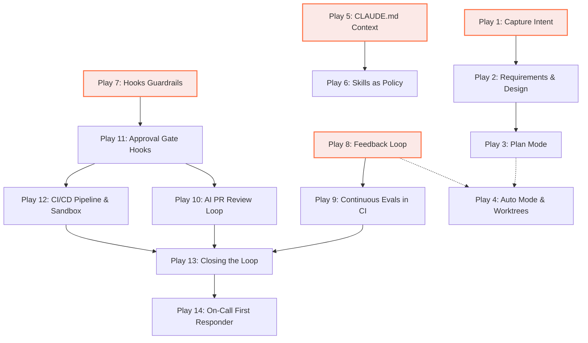

# The AI-Native SDLC Master Knowledge Base

Welcome to the **AI-Native Software Development Lifecycle (SDLC) OpenKnowledge Wiki**. This repository codifies the operational transformation of software development from a human-speed, ticket-driven waterfall ("The Line") into an agent-accelerated, autonomous continuous feedback cycle ("The Loop").

```mermaid
graph TD
    subgraph Traditional_The_Line ["Traditional SDLC: The Line (Weeks to Quarters)"]
        direction LR
        P0[Plan] --> D0[Design] --> B0[Build] --> T0[Test] --> DP0[Deploy] --> M0[Maintain]
    end

    subgraph AINative_The_Loop ["AI-Native SDLC: The Loop (Hours, with Humans Above the Loop)"]
        P[Stage 1: Plan\nintent.md] --> D[Stage 2: Design\nspec.md]
        D --> B[Stage 3: Build\nplan.md + Code]
        B --> T[Stage 4: Test\nFeedback & Evals]
        T --> DP[Stage 5: Deploy\nPR Review & Hook Gates]
        DP --> M[Stage 6: Maintain\nBands & Claude on Call]
        M -->|Anomaly / Drift -> intent.md| P
    end

    style Traditional_The_Line fill:#f8f9fa,stroke:#adb5bd,stroke-width:1px
    style AINative_The_Loop fill:#e8f4fd,stroke:#1a73e8,stroke-width:2px
```

---

## 1. Executive Summary & Core Paradigm

In the traditional SDLC, code implementation was the most expensive and time-consuming bottleneck. Engineering rituals (PRDs, sizing ceremonies, architecture reviews, QA handoffs) were designed to control human uncertainty.

Today, agentic AI has collapsed implementation time to hours. As a result:
1. **The bottleneck has shifted** to the left (Plan, Design) and right (Review, Test, Deploy, Maintain).
2. **Line-by-line manual reviews are intractable** when AI writes most of the diff.
3. **The committed artifact is the single source of truth and audit trail**: Every stage consumes a version-controlled Markdown or code artifact and emits a new one (`intent.md` $\rightarrow$ `spec.md` $\rightarrow$ `plan.md` $\rightarrow$ `code+evals` $\rightarrow$ `REVIEW.md` $\rightarrow$ `bands.yaml`).
4. **Humans remain above the loop**: Rather than being in the critical path of typing or manual verifying, humans direct intent, resolve escalated policy contradictions, and approve release gates.

---

## 2. Knowledge Architecture & Taxonomy

This OpenKnowledge wiki is organized into 5 primary domains:

| Category | Description | Primary Path |
| :--- | :--- | :--- |
| **Concepts** | Foundational philosophies, paradigm shifts, and architectural invariants. | [`openknowledge/concepts/`](./concepts/) |
| **Stages** | Deep dives into the 6 SDLC lifecycle stages. | [`openknowledge/stages/`](./stages/) |
| **Plays** | Modular, actionable runbooks for engineering, platform, and product teams. | [`openknowledge/plays/`](./plays/) |
| **Templates** | Standardized, machine-readable artifact schemas and production configs. | [`openknowledge/templates/`](./templates/) |
| **Governance** | Auditability, compliance, telemetry, sandboxing, and metrics. | [`openknowledge/governance/`](./governance/) |

---

## 3. The 6 SDLC Stages

1. [**Stage 1 — Plan**](./stages/01-plan.md): From committee backlog refinement to direct originator intent capture (`intent.md`).
2. [**Stage 2 — Design**](./stages/02-design.md): Collapsing requirements and technical design into a single agentic session guided by policy skills (`spec.md`).
3. [**Stage 3 — Build**](./stages/03-build.md): Plan mode as default, parallel worktrees, `CLAUDE.md`, institutional skills, and deterministic hooks.
4. [**Stage 4 — Test**](./stages/04-test.md): Agent self-verification feedback loops, non-regression test hooks, and continuous evals in CI.
5. [**Stage 5 — Deploy**](./stages/05-deploy.md): Dual-direction PR reviews, deterministic hook approval gates, and sandboxed CI/CD deployments.
6. [**Stage 6 — Maintain**](./stages/06-maintain.md): Autonomous closed-loop feedback, statistical control bands (`bands.yaml`), and on-call first responders (`Claude Tag`).

---

## 4. The 14 Implementation Plays

The plays can be adopted modularly. Notice that entry-point plays (clay nodes) require no prerequisites.

### Playbook Directory
- [**Play 01: Capture as `intent.md`**](./plays/play-01-capture-intent.md) *(Entry Point)*
- [**Play 02: Requirements & Design Specification**](./plays/play-02-requirements-and-design.md) *(Depends on Play 01)*
- [**Play 03: Plan Mode as Default Starting Point**](./plays/play-03-plan-mode.md) *(Depends on Play 02)*
- [**Play 04: Auto Mode, Parallel Sessions & Worktrees**](./plays/play-04-auto-mode-and-worktrees.md) *(Depends on Plays 03, 08)*
- [**Play 05: `CLAUDE.md` as Repo Memory**](./plays/play-05-agent-context-claude-md.md) *(Entry Point)*
- [**Play 06: Skills as Operational Institutional Knowledge**](./plays/play-06-skills-as-institutional-knowledge.md) *(Depends on Play 05)*
- [**Play 07: Hooks as Build-Time Guardrails**](./plays/play-07-build-guardrail-hooks.md) *(Entry Point)*
- [**Play 08: Deterministic Verification Feedback Loop**](./plays/play-08-verification-feedback-loop.md) *(Entry Point)*
- [**Play 09: Continuous Evals in CI**](./plays/play-09-continuous-evals-ci.md) *(Depends on Plays 05, 08)*
- [**Play 10: Dual-Direction AI in the PR Review Loop**](./plays/play-10-ai-pr-review-loop.md) *(Depends on Plays 05, 06, 11)*
- [**Play 11: Hooks as Non-Negotiable Approval Gates**](./plays/play-11-hooks-as-approval-gates.md) *(Depends on Play 07)*
- [**Play 12: CI/CD Integration, Sandboxing & MCP Deployments**](./plays/play-12-cicd-pipeline-and-sandboxing.md) *(Depends on Plays 10, 11)*
- [**Play 13: Closing the Loop with Statistical Control Bands**](./plays/play-13-closing-the-loop-control-bands.md) *(Depends on Plays 01, 09, 10, 12)*
- [**Play 14: Claude on Call (Incident Triage & Memory)**](./plays/play-14-on-call-first-responder.md) *(Depends on Play 13)*

---

## 5. Artifact Chain of Custody & Templates

| Stage | Input Artifact | Output Artifact | Production Template |
| :--- | :--- | :--- | :--- |
| **Plan** | Human problem statement | `intent.md` | [`intent.template.md`](./templates/intent.template.md) |
| **Design** | `intent.md` + Policy Skills | `spec.md` | [`spec.template.md`](./templates/spec.template.md) |
| **Build** | `spec.md` + `CLAUDE.md` | `plan.md` + Code Diff | [`plan.template.md`](./templates/plan.template.md), [`claude-context.template.md`](./templates/claude-context.template.md) |
| **Test** | Verification scripts | Proof + `evals/*.json` | [`verifier-agent.template.md`](./templates/verifier-agent.template.md), [`ci-evals-workflow.template.yml`](./templates/ci-evals-workflow.template.yml) |
| **Deploy** | Pull Request + `REVIEW.md` | PR Review Verdicts | [`review-policy.template.md`](./templates/review-policy.template.md), [`hook-production-gate.template.sh`](./templates/hook-production-gate.template.sh), [`enterprise-managed-settings.template.json`](./templates/enterprise-managed-settings.template.json) |
| **Maintain**| Production telemetry | `bands.yaml` $\rightarrow$ `intent.md` | [`bands.template.yaml`](./templates/bands.template.yaml) |

---

## 6. Governance, Compliance & Observability

- [**Audit Trail & Chain of Custody**](./governance/audit-trail-and-chain-of-custody.md): How Git commit logs replace manual compliance documentation.
- [**Leading & Lagging Metrics Framework**](./governance/leading-and-lagging-metrics.md): Comprehensive instrumentation via OpenTelemetry and DORA.
- [**Enterprise Security, Permissions & Sandboxing**](./governance/enterprise-security-and-sandboxing.md): OS isolation, credential shielding, and MDM-managed configurations.
- [**Legacy System Coexistence (Jira, ServiceNow, Figma)**](./concepts/legacy-systems-source-of-truth.md): Single source of truth vs linkage models.

---

## 7. Official Anthropic References

- Admin Setup Decision Map: `https://code.claude.com/docs/en/admin-setup`
- Settings Reference: `https://code.claude.com/docs/en/settings`
- Server-Managed Settings: `https://code.claude.com/docs/en/server-managed-settings`
- Permissions Reference: `https://code.claude.com/docs/en/permissions`
- Sandboxing & Isolation: `https://code.claude.com/docs/en/sandboxing`
- Hooks Reference & Guide: `https://code.claude.com/docs/en/hooks`
- Agent Skills Reference: `https://code.claude.com/docs/en/skills`
- Managed MCP & Plugin Marketplaces: `https://code.claude.com/docs/en/managed-mcp`
- OpenTelemetry Monitoring: `https://code.claude.com/docs/en/monitoring-usage`
