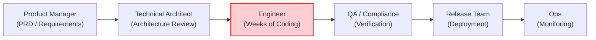

# Code is No Longer the Bottleneck

Organizations have started using AI to write code at a velocity unimaginable in prior software engineering eras. Yet in most enterprises, the processes surrounding code implementation remain frozen in legacy paradigms.

Engineering teams still rely on the same ticket queues, multi-stage approval committees, synchronous handoffs, and manual code review policies—completely stalling the productivity gains promised by agentic coding tools like Claude Code.

---

## 1. The Historical Context of the Traditional SDLC

The traditional Software Development Lifecycle (SDLC) was forged to maximize efficiency in an era where **the most expensive, uncertain, and time-consuming stage was writing code**:

*   **Long Alignment Rituals:** PRDs, sizing ceremonies (planning poker, story points), and architectural change boards existed specifically to force alignment *before* committing engineers to weeks or quarters of expensive manual coding.
*   **Human-Centric Controls:** The controls assumed that every single line of code was hand-typed by a human, and that human attention was available at every juncture to verify line-by-line correctness.

---

## 2. What Happens When Code Implementation Collapses

When AI agents compress the implementation phase from weeks to hours, three systemic truths emerge:

### Truth 1: The Bottleneck Moves to the Periphery
The constraint shifts completely to the stages immediately to the left and right of the build phase:
*   **To the left:** Planning and Requirements/Design (still running at meeting and workshop speed).
*   **To the right:** Code Review, QA testing, and Deployment Approvals (still running at human queue speed).

```mermaid
flowchart TD
    subgraph Before_Agents ["Before Agents: Build dominates duration"]
        B_P[Plan] --> B_D[Design] --> B_B["BUILD (Weeks/Months)"] --> B_T[Test] --> B_Dep[Deploy] --> B_M[Maintain]
    end

    subgraph After_Agents ["After Agents: Build collapses; Periphery dominates"]
        A_P["Plan (Human Speed)"] --> A_D["Design (Human Speed)"] --> A_B["BUILD (Hours)"] --> A_T["Test (Human Speed)"] --> A_Dep["Deploy (Human Speed)"] --> A_M["Maintain (Human Speed)"]
    end

    style B_B fill:#ef5350,stroke:#b71c1c,color:#fff
    style A_B fill:#81c784,stroke:#2e7d32,color:#000
    style A_P fill:#ffb74d,stroke:#e65100
    style A_D fill:#ffb74d,stroke:#e65100
    style A_T fill:#ffb74d,stroke:#e65100
    style A_Dep fill:#ffb74d,stroke:#e65100
```

### Truth 2: Existing Verification Controls Become Intractable
Reviewing every line of diff by hand made sense when a human spent three days crafting 150 lines. But when an agent synthesizes 2,000 lines of fully tested, formatted diff in three minutes:
*   Either the human PR review queue grows uncontrollably, delaying delivery;
*   Or code ships under-reviewed due to human "LGTM" fatigue, introducing catastrophic risk.
*   Regulated organizations (fintech, healthcare, defense) cannot tolerate either outcome.

### Truth 3: Governance Costs Explode
Exceptions and architectural waivers route through weekly or monthly committee cadences. When development iterations occur hourly, waiting for a bi-weekly architecture board inflates latency by orders of magnitude.

---

## 3. The Resolution

To realize the value of AI and guarantee enterprise security, the software development lifecycle requires **the exact same level of architectural transformation that code writing has undergone**.

We must replace human-speed handoffs with **autonomous agent loops**, enforce policies continuously via **version-controlled skills and deterministic hooks**, and shift human attention **above the loop**.
