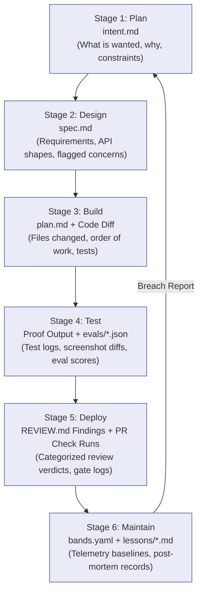

# Committed Artifacts as the Immutable Audit Trail

The linchpin that binds every stage of the AI-Native SDLC together is the **committed artifact**.

Every stage ends by writing an artifact to version control (Git), and the next stage begins by reading that artifact.

```
Every stage commits an artifact the next stage can read.
Together, the intent, the spec, the plan, the diff,
and the review findings are the audit trail.
```

---

## 1. Why Markdown (`.md`) is the Lingua Franca

In early SDLC stages (Plan, Design, Architecture Plan), Markdown files are the primary medium:
*   **Dual Consumption:** A Markdown file is effortlessly authored, parsed, and iterated on by both human business stakeholders (product managers, risk officers) and AI agents.
*   **Version Controlled:** Stored directly in Git alongside the source code, benefiting from full branching, history diffing, PR reviews, and cryptographic commit signatures (`commit SHA`).
*   **Machine-Actionable:** Structured headings, frontmatter, and bullet points allow agents to ingest constraints deterministically without ambiguous interpretation.

---

## 2. The Artifact Chain of Custody

The chain flows progressively through the stages:



### Artifact Specifications

| Stage | Artifact Name | Owner / Origin | Contents | Next Trigger |
| :--- | :--- | :--- | :--- | :--- |
| **Stage 1: Plan** | `intent.md` | Problem Originator + Agent | Problem, proposed outcome, affected systems, constraints, open questions. | Merge triggers Stage 2 |
| **Stage 2: Design** | `spec.md` | Product Owner + Policy Skills | Requirements, architecture delta, UX mocks, flagged policy trade-offs. | Sign-off triggers Stage 3 |
| **Stage 3: Build** | `plan.md` | Lead Engineer + Agent | Files to change, execution order, risk analysis, verification proof targets. | Engineer accepts to start coding |
| **Stage 4: Test** | Test logs / Evals | Toolchain & Agent | Terminal outputs (`make test`), screenshot diffs, CI eval reports. | Checked into PR bundle |
| **Stage 5: Deploy** | `REVIEW.md` + PR checks | Agent Reviewer + Code Owner | Three-pass review findings (Bugs, Security, Spec Compliance), severity tally. | Release manager gate |
| **Stage 6: Maintain** | `lessons/*.md` | On-Call Agent + Responder | Incident timeline, root cause, deploy diff link, permanent eval test. | Fed back into `CLAUDE.md` / repo |

---

## 3. Compliance and Audit Invariants

In regulated industries (banking, healthcare, aerospace), auditors demand answers to three fundamental questions:
1. **Who authorized this change?** Answered by the author metadata and PR approvals in `intent.md` and `spec.md`.
2. **Did the implementation adhere to organizational policies?** Answered by the skill versions evaluated during the design and build passes, and verified against `REVIEW.md`.
3. **What was tested, and how do we know the tests weren't weakened?** Answered by the pre-commit test proof logs and the hook that blocks edits to test files during bug fixing.

Because Git logs every author, timestamp, hash, and PR conversation, **the Git commit history replaces external manual compliance binders**.
