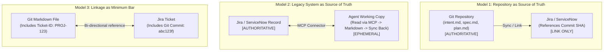

# Legacy Systems and the Source of Truth

Enterprise software development rarely happens on a blank slate. Work items live in Jira, requirements in regulatory compliance portals (e.g. Jama, DOORS), designs in Figma, and change controls in ServiceNow.

These legacy systems cannot be eliminated overnight—auditors trust them, external departments depend on them, and legal requirements enforce them. The AI-Native SDLC accommodates these systems via explicit **Source of Truth** architectures.

---

## 1. The Core Invariant: Name Exactly One Source of Truth

When transitioning, declare **one system as the authoritative source of truth for each artifact**, with all other tools holding copies or hyperlinks.



---

## 2. The Three Architectural Patterns

### Pattern 1: The Repo as the Source of Truth (Recommended for Engineering-Led Orgs)
*   **Architecture:** Markdown artifacts (`intent.md`, `spec.md`, `plan.md`) checked into Git are the canonical records.
*   **Legacy Behavior:** The Jira issue or ServiceNow change ticket is updated programmatically by CI or hooks, storing links directly to the Git commit hash.
*   **Advantages:** Complete unified timeline, single cryptographic authority (`git log`), zero sync drift between requirements and implementation diffs.

### Pattern 2: The Legacy System as the Source of Truth
*   **Architecture:** Jira, ServiceNow, or a specialized requirements database holds the official legal record.
*   **Agent Interaction:** The agent reads the ticket via an **MCP (Model Context Protocol)** connector at session startup, converts it into working Markdown context, and writes back the generated spec or plan into the ticket fields upon completion.
*   **Advantages:** Regulators and non-engineering stakeholders see zero process change; all audit reports continue exporting from existing tools.

### Pattern 3: Linkage as the Minimum Bar (Transition Baseline)
*   **Architecture:** Both systems coexist as recognized dual records.
*   **Enforcement:**
    *   Every Git artifact MUST state the issue key in its frontmatter:
        ```markdown
        # Intent: claims status self-service
        Jira-Key: PROJ-8492
        Commit-Sha: 4a2b9f1
        ```
    *   Every legacy record MUST include the Git commit SHA where the corresponding Markdown artifact was committed.
*   **Advantages:** Instant adoption with zero infrastructure re-architecture.
