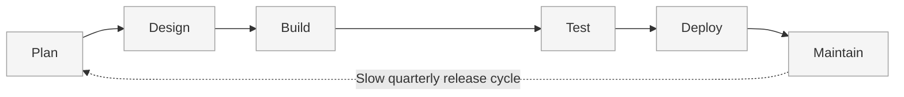
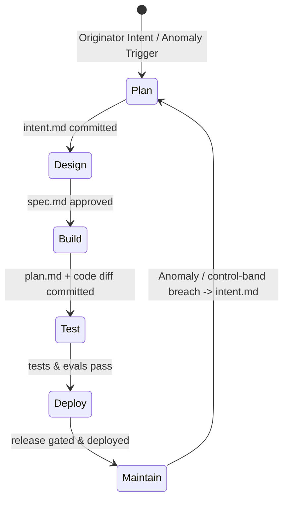
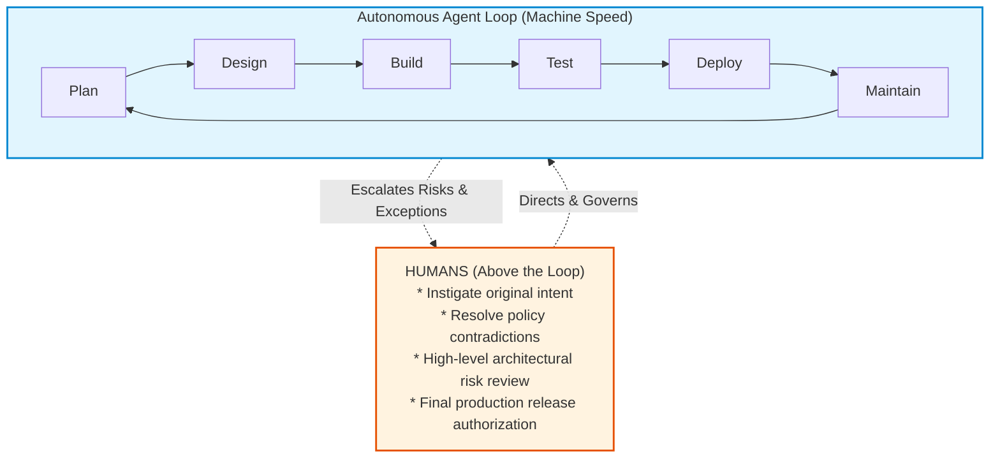

# The Line vs. The Loop

The defining architectural transformation of an AI-Native organization is the shift from **The Line** to **The Loop**.

---

## 1. The Line: Traditional SDLC

The legacy lifecycle operates as a unidirectional line:

### Characteristics of The Line
*   **Linear & Sequential:** Stage $N+1$ cannot start until Stage $N$ is manually signed off.
*   **Lossy Handoffs:** An idea travels through tickets, requirement documents, architect diagrams, and backlog refinement. By the time it reaches the engineer, the context is divorced from the originator's intent.
*   **Reactive Maintenance:** Bugs and telemetry anomalies sit in issue trackers for weeks until prioritized in future planning cycles.
*   **Humans in the Critical Path:** A human is required to initiate, execute, verify, and pass each artifact between stages.

---

## 2. The Loop: AI-Native SDLC

The AI-Native lifecycle transforms software delivery into a tightly coupled, continuous, automated cycle running in **hours rather than weeks**:

### Characteristics of The Loop
1. **AI Embedded at Every Node:** Rather than AI being merely a code-completion autocomplete tool in the IDE, AI acts at Planning, Design, Implementation, QA, Review, and Observability.
2. **Automated Handover:** Committing the output artifact of one stage automatically initiates the non-interactive agent run for the next stage.
3. **Autonomous Feedback:** Breached production metrics or operational incidents automatically generate new `intent.md` artifacts, restarting the loop without human prompting.

---

## 3. Humans Above the Loop

A common misconception is that an AI-native SDLC removes humans or sacrifices governance. In reality:

> **Humans remain fully accountable, but shift from being "in the loop" to "above the loop".**

*   **Instigating:** Humans articulate the core customer problems, business goals, and strategic trade-offs.
*   **Directing:** Humans define the organizational policies, brand rules, and security guidelines as version-controlled skills and hook configurations.
*   **Governing:** Humans review flagged edge cases, approve high-risk architectural decisions, and hold the physical key at deployment gates.
