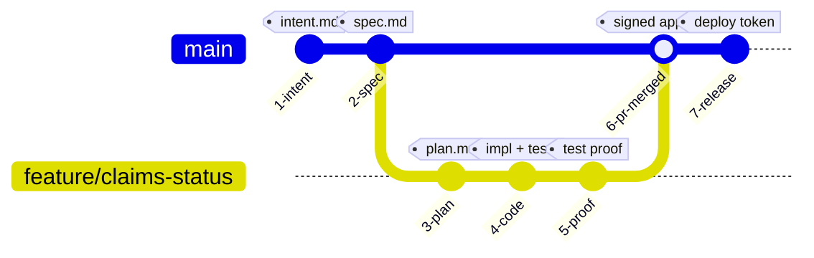

# Audit Trail and Chain of Custody

In high-assurance engineering environments (banking, healthcare, defense, enterprise SaaS), external auditors (SOC 2 Type II, ISO 27001, FedRAMP) require continuous evidence that:
1. Every software change was explicitly requested by an authorized human.
2. Architecture, security, and privacy policies were checked prior to code generation.
3. Automated testing verified functional correctness without tests being weakened.
4. Independent human approval was granted prior to production release.

---

## 1. The Cryptographic Chain of Commits

Instead of maintaining brittle Word documents or manual Jira sign-off sheets, the AI-Native SDLC treats the **Git commit graph as the immutable audit trail**.

---

## 2. Evidence Mapping by Lifecycle Stage

| SDLC Stage | Auditor Question | Verifiable Evidence | Cryptographic Anchor |
| :--- | :--- | :--- | :--- |
| **Stage 1: Plan** | *"Who originated this requirement?"* | Author metadata and initial commit of `intent.md`. | Git commit SHA & author signature |
| **Stage 2: Design** | *"Were security and brand standards applied?"* | `spec.md` with referenced policy skill versions and logged decisions. | Git commit SHA |
| **Stage 3: Build** | *"Did engineers review architecture before implementation?"* | `plan.md` committed prior to code changes; OpenTelemetry session transcript. | Git commit SHA & OTel trace ID |
| **Stage 4: Test** | *"Did the code pass tests? Were tests altered to mask failures?"* | Literal test execution output attached to PR; PreToolUse hook preventing test edits. | CI check run logs & Git diff |
| **Stage 5: Deploy** | *"Who approved release to production?"* | Dual-direction `REVIEW.md` checklist; signed `RELEASE_APPROVAL` token. | GitHub branch protection signature |
| **Stage 6: Maintain** | *"Were production regressions caught and resolved?"* | Control band logs (`bands.yaml`), post-mortems in `lessons/*.md`, permanent eval in CI. | CI test report & Git log |

---

## 3. Preservation of Separation of Duties

A fundamental requirement of enterprise governance is **Separation of Duties (SoD)**:
*   The entity creating code cannot approve or deploy the code.
*   In the AI-Native SDLC, this is guaranteed because:
    1. The AI agent holds no commit permissions to `main`.
    2. Branch protection strictly requires an authorized human code owner signature.
    3. Production deploy hooks reject commands unless a verified human authorization token is active.
