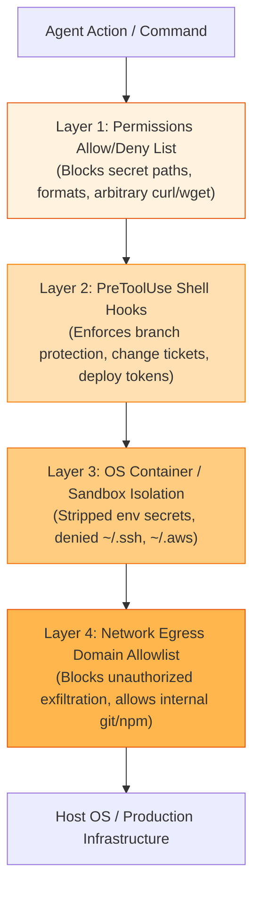

# Enterprise Security, Permissions and Sandboxing

In enterprise and regulated organizations, granting an autonomous agent terminal execution power presents significant security challenges.

The AI-Native SDLC addresses this through defense-in-depth: combining **fine-grained tool permissions**, **OS-level sandboxing**, **deterministic hooks**, and **centrally managed MDM configurations**.

---

## 1. The Defense-in-Depth Security Model

---

## 2. What Each Security Control Guarantees

### 1. `permissions.deny`
*   Keeps sensitive configuration files out of the agent's context window:
    `"deny": ["Read(.env*)", "Read(./secrets/**)", "WebFetch", "Bash(curl *)", "Bash(wget *)"]`
*   Blocks arbitrary outbound HTTP calls from within tool execution.

### 2. `permissions.allow`
*   Pre-approves the safe, repetitive inner-loop developer commands:
    `"allow": ["Bash(git *)", "Bash(make build)", "Bash(make test)", "Bash(make lint)"]`
*   Eliminates prompt fatigue for routine tasks without compromising security.

### 3. `disableBypassPermissionsMode` & `allowManagedPermissionRulesOnly`
*   Disables command-line flags (such as `--dangerously-skip-permissions`).
*   Ensures individual developers or project-level files cannot widen permissions.

### 4. OS-Level Sandboxing
*   A tool-level deny on `WebFetch` does not prevent a bash command from reaching the network.
*   **The OS Sandbox closes this gap:** Blocks network egress outright, permitting traffic only to explicitly allowlisted domains (`git.internal.example.com`, `registry.npmjs.org`).
*   Denies access to sensitive user directories (`~/.ssh`, `~/.aws/credentials`).
*   Strips sensitive tokens (`GITHUB_TOKEN`, `AWS_SECRET_ACCESS_KEY`) from the environment of every sandboxed process.

### 5. `failIfUnavailable` & `allowUnsandboxedCommands: false`
*   The agent **refuses to initialize or start** if the OS sandbox cannot be spawned.
*   Commands that fail inside the sandbox cannot be retried outside of it.

### 6. Centralized MDM Distribution
*   Configuration is deployed by IT administrators via MDM or the enterprise admin console.
*   Developers and agents have read-only access to policies, guaranteeing universal compliance across the fleet.
