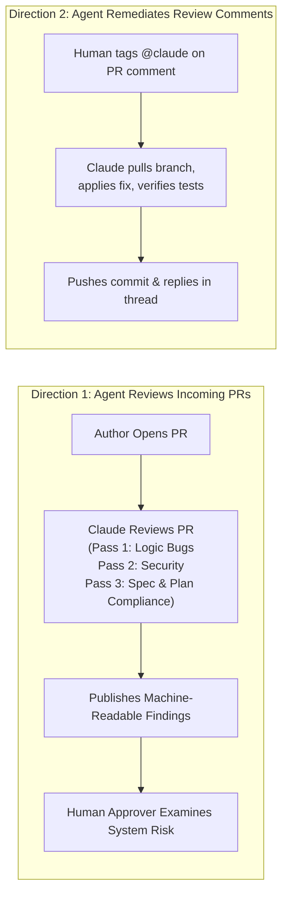

# Play 10: Dual-Direction AI in the PR Review Loop

## 1. What Changes

*   **Before:** Code review capacity is tied strictly to human hours. PRs sit in reviewer queues for days, review thoroughness degrades with cognitive fatigue, and authors spend significant time chasing reviewers.
*   **After:** Claude participates **bidirectionally in the PR loop**. It reviews incoming PRs against explicit policies (`REVIEW.md`), and when tagged on PR comments, it inspects critiques, pushes fixes, and reruns tests autonomously.

---

## 2. The Dual Directions of AI Code Review



---

## 3. Concrete Steps for Implementation

1.  **Draft Repository Review Policy (`REVIEW.md`):**
    Establish explicit review guidelines at the repository root:
    *   **Pass 1 (Bugs & Regressions):** Logical flaws, off-by-one errors, race conditions.
    *   **Pass 2 (Security):** Injection risks, authentication omissions, plaintext secrets, unmasked PII.
    *   **Pass 3 (Compliance):** Does the diff faithfully match `spec.md` and `plan.md`?
2.  **Define What "Important" Means:**
    Instruct the agent to reserve high-severity tags strictly for data corruption, security breaches, or behavioral deviations.
3.  **Cap the Nits:**
    Restrict stylistic nits to **no more than 5 per review** (summarizing the remainder as a single count) to prevent PR comment spam.
4.  **Tag `@claude` for Interactive Fixes:**
    When reviewers leave actionable comments, they simply tag `@claude`. The `claude-code-action` runs, interprets the feedback, pushes the change, and marks the conversation resolved.
5.  **Feed Errors Back into `CLAUDE.md`:**
    If a review comment catches a recurring anti-pattern for the second time, the fix PR **must add that convention to `CLAUDE.md`**.

---

## 4. Production Example: `REVIEW.md`

```markdown
# Review Instructions

## Passes
Execute three distinct passes and tag every finding:
- **Bugs:** Logic errors, unhandled nulls, concurrency deadlocks, edge regressions.
- **Security:** Injection vectors, broken auth guards, PII exposed in logs.
- **Compliance:** Verify the diff faithfully satisfies `spec.md` and `plan.md`.

## What "Important" Means Here
Reserve the `Important` severity tag exclusively for findings that break functionality, leak sensitive data, or violate compliance. Formatting, syntax choices, and variable naming are categorized as `Nit`.

## Cap the Nits
Report at most 5 stylistic nits per review. Summarize any additional minor points in a single line summary.

## Do Not Report
- Any code inside generated directories (`src/gen/`, `build/`).
- Stylistic issues already handled by CI linters (`make lint`).
```

---

## 5. Governance Considerations

*   **Separation of Duties:** The agent that drafted the code **has zero authority to approve or merge the PR**.
*   **Human Gating:** Merging requires explicit code owner approval under branch protection rules. Human reviewers elevate their attention from hunting typos to evaluating business intent and systemic architectural risk.

---

## 6. How to Measure Success

| Metric Type | Metric Name | Measurement Source | Target / Expectation |
| :--- | :--- | :--- | :--- |
| **Leading Indicator** | Time to First Review | GitHub PR webhook events | Under 5 minutes for 100% of pull requests. |
| **Lagging Indicator** | Escaped Defects to Production | Incident reports | Marked decline in post-merge regression incidents. |
