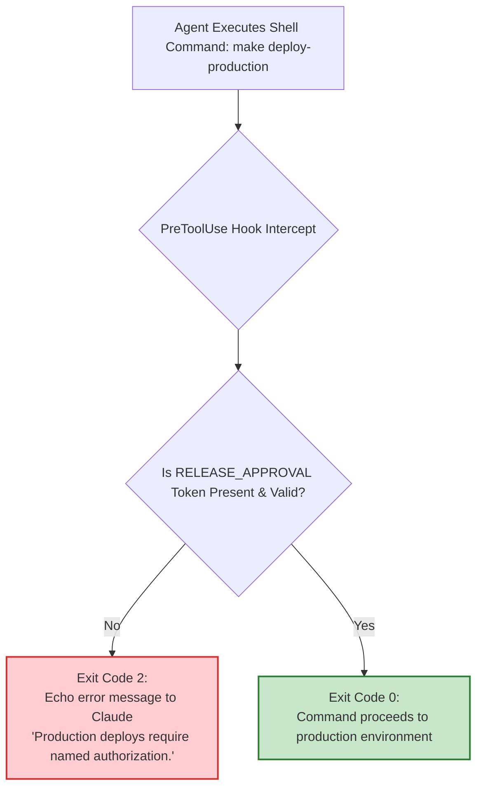

# Play 11: Hooks as Non-Negotiable Approval Gates

## 1. What Changes

*   **Before:** Production approval gates rely on verbal agreements, manual ticket checkboxes in Jira, or ad-hoc Slack messages. In the rush of incident response or rapid deployments, human gates are frequently circumvented.
*   **After:** Every deployment or high-risk operational action is gated by a **deterministic PreToolUse shell hook**. An agent running locally or in CI cannot trigger a release command without an authorized cryptographic token or explicit human sign-off.

---

## 2. The Architectural Principle

> **The agent does everything up to the production gate, and nothing past it.**

Build hooks (Play 07) run silently to format files or block illegal writes. **Approval gate hooks** pause execution and demand explicit human credentials before permitting execution.



---

## 3. Concrete Steps for Implementation

1.  **Enumerate Mandatory Human Gates:**
    Collaborate with release engineering, security, and compliance to list the operations that must never execute unassisted:
    *   Deployments to production environments.
    *   Executing database schema migrations that drop columns or tables.
    *   Provisioning IAM roles or updating cryptographic keys.
2.  **Author the Interception Script (`production-gate.sh`):**
    Inspect tool input via STDIN. If the command targets protected environments or operations, verify authorization tokens:
    ```bash
    #!/bin/bash
    # Read tool input payload from STDIN
    cmd=$(jq -r '.tool_input.command' < /dev/stdin)

    # Intercept production deploy attempts
    if [[ "$cmd" =~ deploy.*production || "$cmd" =~ helm.*prod ]]; then
      if [ -z "$RELEASE_APPROVAL" ]; then
        echo "BLOCKED: Production deployments require signed release authorization." >&2
        echo "Obtain an approval ticket or set RELEASE_APPROVAL with release manager signature." >&2
        exit 2 # Exit code 2 aborts the tool call and feeds message back to Claude
      fi
    fi

    exit 0
    ```
3.  **Wire Hook in Configuration (`.claude/settings.json`):**
    ```json
    {
      "hooks": {
        "PreToolUse": [
          {
            "matcher": "Bash",
            "hooks": [
              {
                "type": "command",
                "command": "${CLAUDE_PROJECT_DIR}/.claude/hooks/production-gate.sh"
              }
            ]
          }
        ]
      }
    }
    ```
4.  **Lock Settings via Enterprise MDM:**
    In corporate environments, prevent local developers from overriding hooks by activating `allowManagedHooksOnly: true` in the centrally deployed managed settings file.

---

## 4. Governance Considerations

*   **100% Enforced Invariant:** Gate logic executes universally across all engineer machines and CI runners.
*   **Tamper-Proof Audit Trail:** Allow and block verdicts are recorded with timestamps, user identities, and command arguments in the OpenTelemetry audit stream.

---

## 5. How to Measure Success

| Metric Type | Metric Name | Measurement Source | Target / Expectation |
| :--- | :--- | :--- | :--- |
| **Leading Indicator** | Gate Wait Latency | OpenTelemetry logs | Exact tracking of time elapsed between agent block and release sign-off. |
| **Lagging Indicator** | Unauthorized Deployments | Cloud audit logs (CloudTrail) | Exactly zero unauthorized or un-ticketed releases. |
