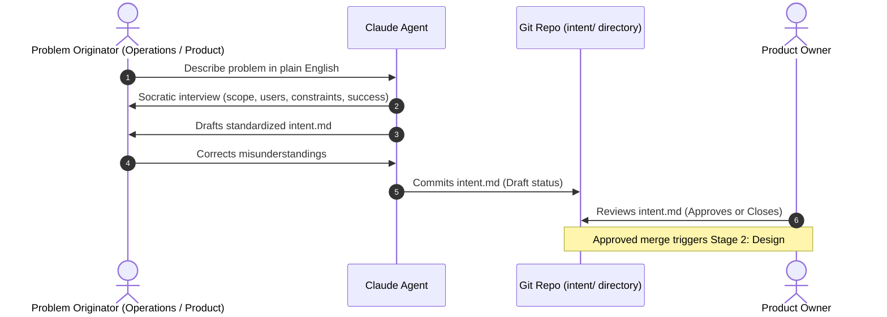

# Stage 1: Plan — Capturing Intent

In the AI-Native SDLC, ideas stop waiting for someone to write them up.

Instead of an idea traveling through fragmented backlog entries, story pointing meetings, and lossy handoffs, **intent is captured once, in the originator's own natural words**, as an actionable, version-controlled artifact: `intent.md`.

---

## 1. Traditional vs. AI-Native Planning

| Dimension | Traditional SDLC | AI-Native SDLC |
| :--- | :--- | :--- |
| **Originator Experience** | Originator must lobby a product manager or business analyst to write a ticket. | Originator talks directly with Claude to capture and refine their vision. |
| **Artifact** | Disconnected Jira ticket, slide deck, or PRD draft. | Version-controlled `intent.md` proto-spec in Git. |
| **Fidelity** | Degraded through multiple handoffs and refinement committee filters. | High fidelity: captures user problem, desired outcome, constraints, and open questions in the originator's voice. |
| **Cadence** | Weeks to months across planning sprints. | Minutes to hours in a single brainstorming session. |

---

## 2. Ingress Routes for Intent

Intent can originate from three distinct paths:
1. **Human Initiative:** An end-user, operations analyst, or product lead identifies a feature need or workflow bottleneck.
2. **Issue / Ticket Ingress:** A customer support ticket or business request enters via Jira/Zendesk, prompting an agent to draft an `intent.md`.
3. **Autonomous Operational Anomaly (Stage 6 Loop):** A breached production control band or alert automatically synthesizes an `intent.md` diagnosis to initiate a bug fix.

---

## 3. The Stage 1 Workflow

---

## 4. Key Artifact: `intent.md`

The proto-spec captures 5 core facets:
*   **Problem Statement:** What users or staff cannot do today, quantified where possible.
*   **Proposed Outcome:** What success looks like from the user's perspective.
*   **Affected Users & Systems:** Scope of dependencies and impact.
*   **Constraints:** Security, data protection (e.g. no new PII), auth, or architectural boundaries.
*   **Open Questions:** Unresolved trade-offs flagged for technical or policy review.

See full schema in [Intent Template](../templates/intent.template.md).

---

## 5. Metrics & Governance

*   **Leading Metric:** Time from first conversation to committed `intent.md` (Target: reduce multi-week elicitation to under 2 hours).
*   **Lagging Metric:** Survival rate (% of `intent.md` merged into Design vs closed) and requirements volatility after Stage 2.
