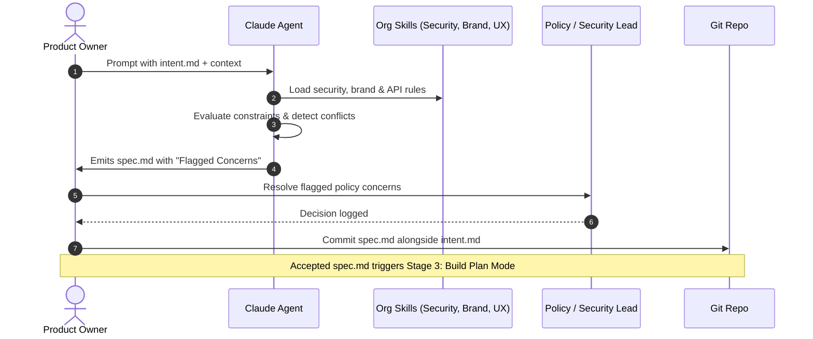

# Stage 2: Design — Requirements & Design Specification

In Stage 2, **requirements analysis and technical design collapse into a single prompted session**.

Instead of waiting weeks for architects and policy boards to discover compliance violations, organizational policies (brand, security, UX, regulatory) are encoded as **version-controlled skills** and applied *while the spec is being drafted*.

---

## 1. Traditional vs. AI-Native Design

| Dimension | Traditional SDLC | AI-Native SDLC |
| :--- | :--- | :--- |
| **Separation of Work** | Analysts write requirements; architects write design; security reviews later. | Agent reads `intent.md`, queries repo architecture, and generates a unified specification. |
| **Policy Checking** | Discovered late in review gates weeks into the project. | Applied upfront as generative constraints through organizational skills. |
| **Artifact** | Sprawling Confluence pages and static architecture diagrams. | Machine-actionable `spec.md` paired with `intent.md` in version control. |
| **Conflict Resolution** | Buried until code review or security audit. | Agent explicitly surfaces and flags policy contradictions for human escalation. |

---

## 2. The Stage 2 Workflow

---

## 3. The Core Artifact: `spec.md`

The generated specification contains:
*   **Context & Goal Alignment:** Mapping directly back to `intent.md`.
*   **System & API Boundaries:** Interface contracts, endpoint parameters, and data models.
*   **Policy Compliance Declarations:** How security, UX, and performance skills were satisfied.
*   **Flagged Areas of Concern:** The exact dilemmas where requirements tension against policy (e.g. rate limit limits vs caching tradeoffs).

The pair—`intent.md` (what was asked for) and `spec.md` (what was decided)—forms the foundational contract of the build phase.

---

## 4. Front-End Design Acceleration

For user-facing products:
1. Product Owner passes `intent.md` into an interactive visual generator (e.g. Claude Design).
2. The mock is iterated visually within minutes.
3. The mock artifacts and styling tokens are exported directly into the `spec.md` for engineering implementation.

---

## 5. Metrics & Governance

*   **Leading Metric:** Elapsed time between `intent.md` commit and `spec.md` commit.
*   **Lagging Metric:** Requirements rework after implementation commences (counted via `spec.md` commits dated after the first `plan.md` commit).
