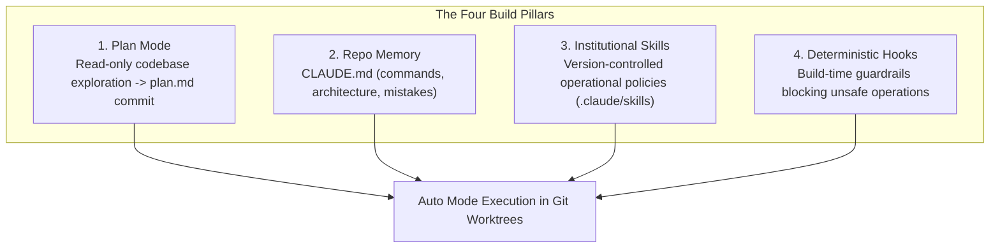

# Stage 3: Build — Plan Mode, Guardrails & Parallel Implementation

In Stage 3, **nothing is implemented without an accepted plan**.

Institutional knowledge transitions from forgotten wikis into version-controlled files the agent reads (`CLAUDE.md`, skills), while guardrails execute as deterministic code (`hooks`) rather than human discipline.

---

## 1. Traditional vs. AI-Native Build

| Dimension | Traditional SDLC | AI-Native SDLC |
| :--- | :--- | :--- |
| **Starting Point** | Engineer reads ticket, starts typing code in private branch. | Engineer starts agent in **Plan Mode**, generating a comprehensive `plan.md`. |
| **Visibility** | Architecture decisions stay in engineer's head until PR. | Plan is committed to Git and reviewed *before a single line of code is edited*. |
| **Institutional Knowledge** | Tribally shared or documented on stale wiki pages. | Maintained in `CLAUDE.md` and repository `skills/` folders. |
| **Guardrails** | Human habits, linting rules, and manual PR callouts. | Deterministic `PreToolUse` hooks blocking illegal edits or unformatted code. |
| **Concurrency** | Single engineer works on one task sequentially. | Single engineer orchestrates 2–3 parallel sessions across Git worktrees. |

---

## 2. The Four Pillars of AI-Native Build

### Pillar 1: Plan Mode as the Invariant
The agent starts in read-only plan mode. It explores the codebase, traces dependencies, and drafts `plan.md`. The engineer interrogates the plan:
*   *What could this change break?*
*   *Which step carries the highest operational risk?*
*   *What architectural alternatives were evaluated and dismissed?*

### Pillar 2: `CLAUDE.md` Context
A single-page, high-density configuration file at the repository root that acts as onboarding context for a new joiner. Contains build commands, test patterns, architecture structure, and "Things Claude gets wrong".

### Pillar 3: Advisory Skills
Folder-based instructions with YAML frontmatter specifying when they trigger. When writing endpoints or touching data models, skills enforce corporate standards (e.g. `secure-api-review`).

### Pillar 4: Deterministic Guardrail Hooks
Skills are advisory; **hooks are deterministic**. A pre-tool hook executes on shell or edit invocations, blocking touches to generated files, stopping unauthorized migrations, or preventing credential leakage.

---

## 3. Scaling via Parallel Sessions and Subagents

*   **Git Worktrees (`claude --worktree <name>`):** Provide clean physical isolation so multiple agent sessions can operate concurrently on different branches without file collisions.
*   **Specialized Subagents:** Scoped assistants with isolated context windows running dedicated routines (e.g. a `verifier` subagent running integration flows or a `simplifier` removing redundant abstractions).

---

## 4. Key Metrics

*   **Leading Metric:** First-pass merge share and time from plan approval to merged PR.
*   **Lagging Metric:** Rework cycles per change and plan drift (% of PR diff that deviated from `plan.md`).
