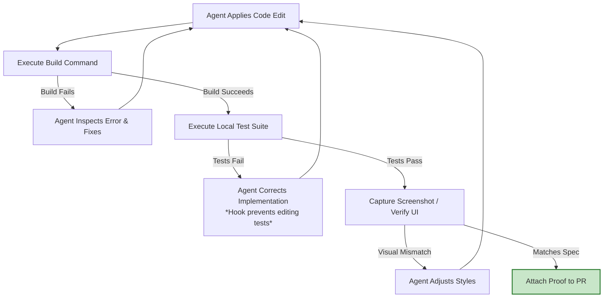

# Stage 4: Test — Feedback Loops & Continuous Evals

In Stage 4, **every session verifies its own work before a human ever inspects the diff**, and **the configuration steering the agent is regression-tested like software**.

---

## 1. Traditional vs. AI-Native Testing

| Dimension | Traditional SDLC | AI-Native SDLC |
| :--- | :--- | :--- |
| **Verification Signal** | Arrives late: CI runs 20 mins later; QA tester tests 3 days later; production fails weeks later. | Immediate inner-loop feedback: agent runs builds, unit tests, and screenshot diffs autonomously. |
| **Bug Fixing** | Engineer fixes code directly, often modifying or deleting tests that fail. | Strict reproduction protocol: agent writes failing test first, commits it, then fixes code under a test-protection hook. |
| **QA Role** | Manual exploratory testing at stage boundaries. | Designing benchmark eval suites that run continuously in CI. |
| **Agent Configuration Testing** | Hope and trial-and-error prompting. | Regression eval suite testing `CLAUDE.md`, skills, and hooks on prompt changes or new model updates. |

---

## 2. The Inner-Loop Verification Feedback

### Invariants of the Feedback Loop
1. **Single Command Target:** Complex workflows wrapped in unified targets (`make test` or `npm test`) that exit non-zero on failure.
2. **Quantifiable Target Definition:** The agent is given explicit success criteria (e.g., `"test_status.py passes with 0 warnings"`).
3. **Protected Test Files:** PreToolUse hooks prevent the agent from solving failures by altering or weakening existing test assertions.
4. **Verifying Before Completion:** The definition of "done" in `CLAUDE.md` requires pasting literal command output before declaring completion.

---

## 3. Continuous Evals in CI

Evals are the AI-native replacement for manual stage-gate QA.

*   **The Problem:** When an engineer edits `CLAUDE.md`, updates a skill, or switches LLM model tiers, how do we guarantee agent performance didn't degrade?
*   **The Solution:** An automated suite of 20–50 canonical engineering tasks executed headlessly in CI (`claude -p`).
*   **Incident-to-Eval Pipeline:** Every production incident spawns a permanent regression eval written by the responding engineering team.

---

## 4. Key Metrics & Governance

*   **Leading Metric:** First-pass CI success rate for agent-written pull requests; Mean Time from Incident to Eval.
*   **Lagging Metric:** PR review cycle time and Change Failure Rate (CFR) in production.
