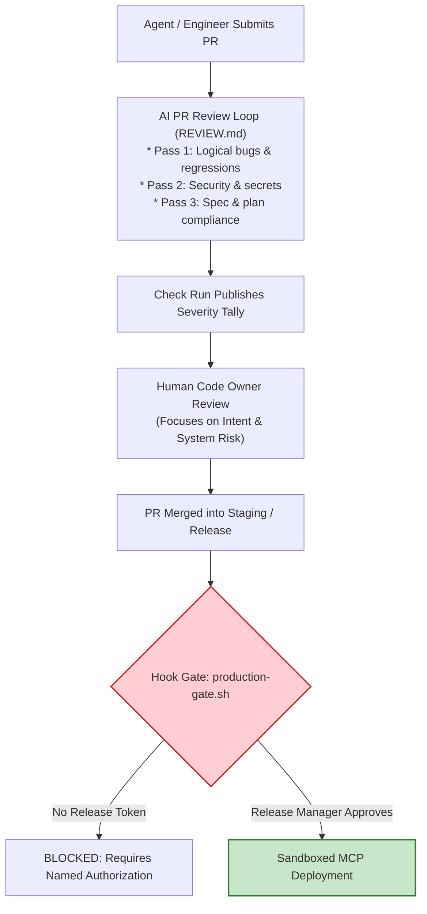

# Stage 5: Deploy — Review Loops, Gate Hooks & Sandboxed CI/CD

In Stage 5, **review operates in both directions, and governance executes as code**.

The core operational doctrine of AI-Native deployment is simple and uncompromising:

> **The agent may act up to the production gate, and cannot pass it.**

---

## 1. Traditional vs. AI-Native Deployment

| Dimension | Traditional SDLC | AI-Native SDLC |
| :--- | :--- | :--- |
| **Code Review** | Human reviewer reads every diff line; quality depends on reviewer fatigue. | AI runs structured multi-pass reviews (Bugs, Security, Spec Alignment); human evaluates intent and risk. |
| **Review Feedback** | Human author manually addresses comments and pushes updates. | Author or reviewer tags `@claude`; agent addresses comments, runs tests, and pushes fixes. |
| **Release Gating** | Unenforced verbal sign-offs or manual ticket approvals. | Deterministic `PreToolUse` shell hooks blocking deployment commands unless authorized. |
| **CI Execution** | Static scripts; broken pipelines require human triage. | Non-interactive agents (`claude -p`) triage failures, draft summaries, and suggest targeted fixes. |
| **Production Credentials** | Standing AWS/GCP keys stored in CI runners or developer laptops. | Sandboxed agent environments with zero default production credentials; tools exposed via restricted MCP. |

---

## 2. The Deployment Architecture

---

## 3. The Core Elements of Stage 5

### 1. Dual-Direction PR Review Loop
*   **Agent as Reviewer:** Evaluates every incoming PR against `REVIEW.md` policies, capping stylistic nits (max 5) and focusing on security vulnerabilities and spec compliance.
*   **Agent as Implementer:** When tagged via `@claude` on a PR review comment, the agent investigates the critique, adjusts the implementation, runs local verification, and commits the fix.

### 2. Hooks as Deterministic Approval Gates
*   PreToolUse hooks intercept commands matching `deploy` or `production`.
*   If the required authorization environment variable (`RELEASE_APPROVAL`) or signed token is missing, the hook exits with status `2`, halting execution and printing the exact authorization route to the agent.

### 3. Sandboxing & Managed Settings
*   Agents execute within OS-level sandboxes (restricting filesystem access to `~/.ssh`, `~/.aws`, `.env` files).
*   Network egress is locked to company internal domains and registry endpoints.
*   Settings are enforced via MDM (`managed-settings.json`), disallowing engineers from disabling permission prompts or sideloading unverified plugins.

### 4. Rehearsed Rollback Paths
*   Rollback is exposed to the agent as a first-class MCP tool (`tools/rollback-deploy`).
*   The rollback procedure is exercised continuously in staging so that autonomous remediation in Stage 6 is guaranteed to succeed.

---

## 4. Key Metrics

*   **Leading Metric:** Time to first PR review; share of review comments resolved without human branch checkout; wait time at approval gates.
*   **Lagging Metric:** Escaped production defects, and DORA metrics (Deployment Frequency, Lead Time for Changes, Change Failure Rate, Failed Deployment Recovery Time).
