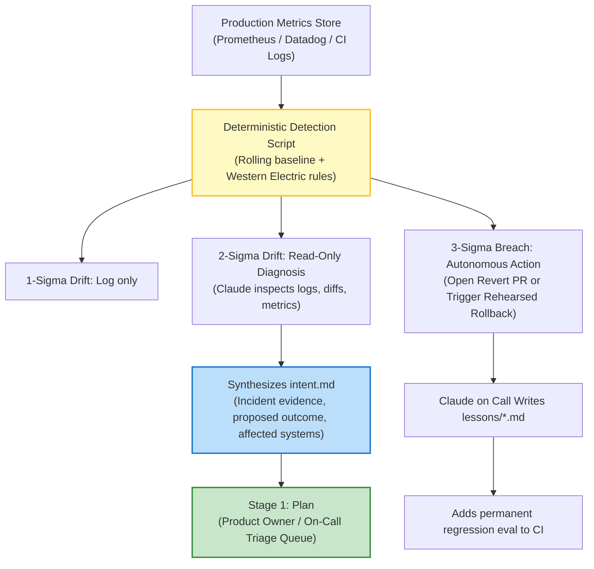

# Stage 6: Maintain — Autonomous Monitoring & Closing the Loop

In Stage 6, **the software lifecycle loop closes**.

Instead of waiting for an engineer to notice a 3:00 AM alert or triage a stagnant backlog ticket, **production telemetry triggers headless agent execution**. What the agent discovers is diagnosed, quarantined, or fed directly back into Stage 1 as a new `intent.md`.

---

## 1. Traditional vs. AI-Native Maintenance

| Dimension | Traditional SDLC | AI-Native SDLC |
| :--- | :--- | :--- |
| **Response Model** | Purely reactive: alerts wake engineers; tickets sit in queues; post-mortems rarely reach code. | Proactive and autonomous: deterministic triggers invoke agents immediately upon statistical drift. |
| **Trigger Path** | Human must log into observability dashboards, triage, and open a ticket. | Headless trigger invokes Claude with **no human in the invocation path**. |
| **Autonomy Boundaries** | Engineers scramble with manual SSH commands and undocumented runbooks. | Tiered autonomy strictly governed by statistical control bands (`bands.yaml`). |
| **Organizational Memory** | Incident notes scattered across Slack threads, Google Docs, and Jira. | Version-controlled post-mortems committed to `lessons/*.md` and converted into permanent CI evals. |

---

## 2. The Closed-Loop Architecture

---

## 3. The Core Mechanisms

### 1. Statistical Process Control Bands (`bands.yaml`)
Detection remains 100% deterministic (no LLM hallucination in the detection path). Mean and standard deviation are calculated over a rolling window (e.g. 30 days) using Western Electric or SPC rules:
*   **$1\sigma$ (In Control):** Log status; no agent invoked.
*   **$2\sigma$ (Early Warning):** Agent invoked read-only (`Read`, `Grep`, `gh run view`) to diagnose root cause and assemble evidence.
*   **$3\sigma$ (Critical Anomaly):** Agent opens a revert PR or invokes a rehearsed rollback MCP tool.

### 2. Autonomous Intent Generation
When a problem is diagnosed, the agent writes an `intent.md` in exact Stage 1 format, detailing:
*   The metric anomaly signature;
*   The offending deploy commit SHA;
*   The affected endpoints or microservices;
*   The recommended remediation.
The on-call engineer or product owner merely reviews and approves the artifact into Stage 2.

### 3. Claude on Call (Collaboration App First Responder)
Via workplace integrations (Slack / Teams), Claude participates directly in incident channels:
*   Correlates incoming error alerts against recent deployment diffs in minutes.
*   Proposes the rehearsed rollback to the incident commander.
*   Upon human confirmation (`"Go"`), executes rollback, verifies metrics return to baseline, and commits the post-mortem to `lessons/<date>-<title>.md`.

---

## 4. Key Metrics

*   **Leading Metric:** Time from control band breach to committed `intent.md` in the triage queue; percentage of incidents triaged autonomously.
*   **Lagging Metric:** Mean Time to Recovery (MTTR) and recurrence rate of identical incident classes.
